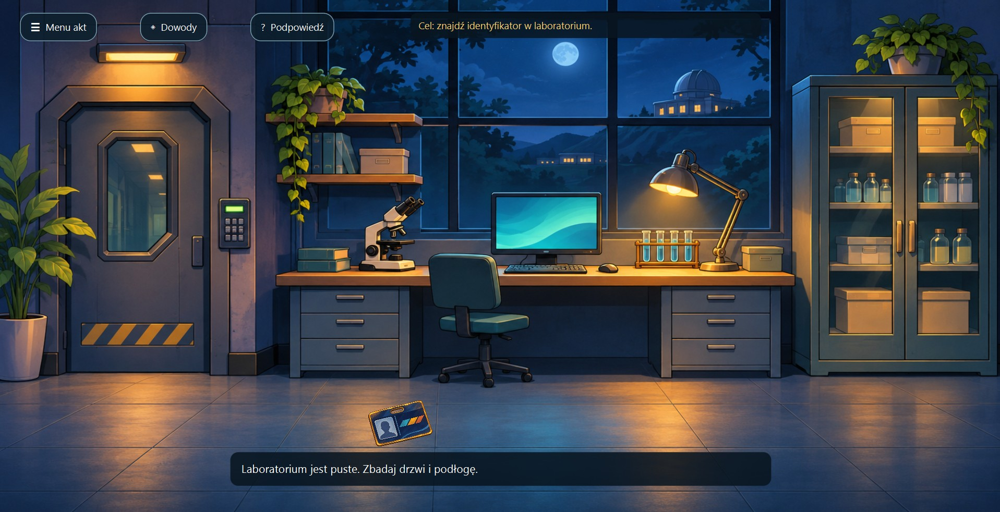

# Akta 01: Zniknięcie prototypu

Okienkowa gra detektywistyczna napisana w Javie i JavaFX. Podczas zamkniętej prezentacji znika prototyp urządzenia. Gra zaczyna się od wyboru akt; druga sprawa jest zapowiedziana w menu, a pierwsza jest grywalna. Laboratorium, korytarz, biuro i magazyn mają pełnoekranowe sceny z klikalnymi przedmiotami i postaciami.

## Podgląd gry



## Rozgrywka

Przeglądaj laboratorium, korytarz i biuro, klikając przedmioty, postacie i drzwi na ilustracjach. Znalezienie identyfikatora prowadzi prosto do zbliżenia czytnika, a podniesienie bezpiecznika do otwartej szafki serwisowej. Odczytujesz dziennik zamka, wkładasz bezpiecznik do pustego gniazda i widzisz, jak kamera wraca do pracy. Dopiero po przywróceniu zasilania możesz odczytać archiwum kamery. Naprawa nie odzyskuje nagrania z chwili wejścia. Godziny na urządzeniach są tekstem gry, więc da się je wyraźnie przeczytać. Na ilustrowanej osi czasu zestawiasz odczyty z przedmiotami i wybierasz wniosek, który naprawdę wynika z dowodów. Błędny wniosek daje konkretną wskazówkę.

Podczas przesłuchań wybierasz pytania w pasie dialogowym, widząc rozmówcę i pokój. Lena mówi, że widziała identyfikator Marka u Oli; na tablicy dowodów porównujesz też ich alibi. Cel widoczny u góry sceny oraz dwupoziomowe podpowiedzi prowadzą przez sprawę. Finał wymaga ułożenia całej teorii: kto ukradł prototyp, jak wszedł do laboratorium i dlaczego to zrobił. Jeśli teoria nie pasuje do dowodów, gra wskazuje konkretną sprzeczność.

Umowa z drukarki podaje kod prototypu P-17 i odbiór z magazynu o 22:00. W magazynie porównujesz kod z oznaczeniami trzech schowków, odnajdujesz prototyp i zabezpieczasz go jako dowód rzeczowy. Odzyskanie urządzenia jest wymagane przed końcowym oskarżeniem. Ilustrowana rekonstrukcja pokazuje kolejność zdarzeń po rozwiązaniu sprawy. Gra zapisuje postęp automatycznie po odkryciach i zmianie pokoju. W menu możesz wybrać **Kontynuuj** albo **Nowa gra**. Zapis znajduje się w `~/.casefile-21-14/save.properties`.

Kod interfejsu znajduje się w `src/pl/detektyw/DetectiveGame.java`, zasady śledztwa w `Investigation.java`, a odczyt i zapis stanu w `CaseSave.java`. Starsza wersja konsolowa korzysta z tych samych zasad śledztwa.

## Uruchomienie

Wymagana Java 17 lub nowsza. Pierwsze uruchomienie wymaga pobrania bibliotek JavaFX przez Maven.

**IntelliJ IDEA:** otwórz `pom.xml` jako projekt Maven i poczekaj na załadowanie zależności. Otwórz panel **Maven** po prawej stronie, następnie **Plugins → javafx → javafx:run**. Pojawi się okno gry. Jeśli panel nie pokazuje wtyczki, kliknij ikonę ponownego załadowania projektów Maven.

**Terminal, wersja okienkowa:**

```powershell
mvn javafx:run
```

**Terminal, starsza wersja konsolowa:**

```powershell
mvn compile
java '-Dfile.encoding=UTF-8' -cp target/classes pl.detektyw.Main
```

